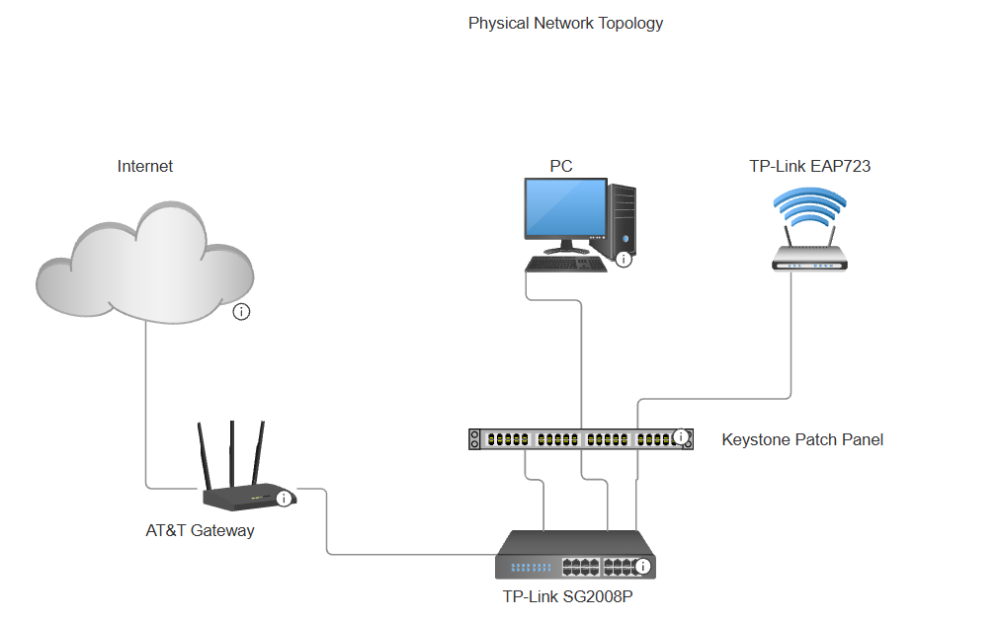
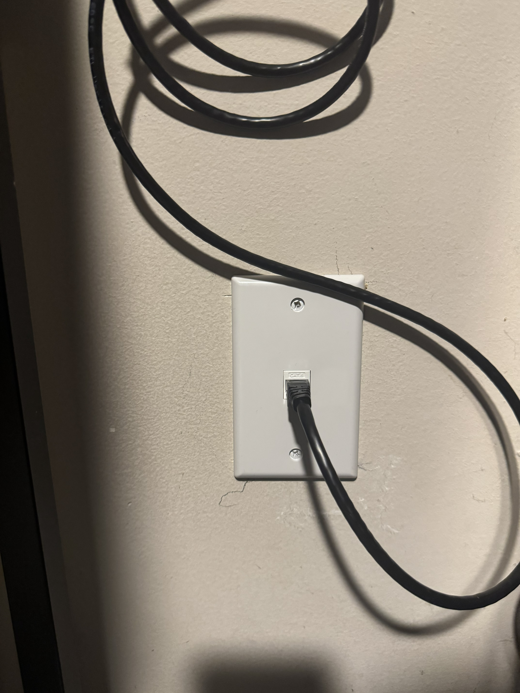

# Network Topology

## 1. Overview

This document describes the physical and logical topology of the residential network, including the network infrastructure, Ethernet connections, and device roles.

The network uses an AT&T gateway for internet connectivity, routing, and DHCP services. A TP-Link Omada SG2008 managed switch provides wired connectivity, while a TP-Link Omada EAP723 wireless access point extends wireless coverage throughout the home.

## 2. Physical Network Topology

The physical topology illustrates how network equipment and end devices are interconnected through Cat6 Ethernet cabling.

### Network Diagram

*Figure 1: Physical network topology showing the gateway, managed switch, patch panel, access point, and wired devices.*

### Infrastructure Components

| Component | Model / Type | Function |
|---|---|---|
| Gateway / Router | AT&T Gateway | Internet connectivity, routing, NAT, and DHCP |
| Managed Switch | TP-Link Omada SG2008 | Ethernet switching and network management |
| Wireless Access Point | TP-Link Omada EAP723 | Wireless network connectivity |
| Patch Panel | Cat6 Keystone Patch Panel | Termination and organization of permanent Ethernet cable runs |
| Ethernet Cabling | Cat6 Solid Copper | Wired network connectivity |
| Ethernet Outlets | Cat6 Keystone Jacks | Wired connections for end devices |

### Physical Connections

- The AT&T gateway connects to the TP-Link SG2008 managed switch.
- The managed switch connects to the patch panel through Ethernet patch cables.
- Permanent Cat6 cable runs connect the patch panel to Ethernet outlets in multiple rooms and the hallway access point.
- The EAP723 provides wireless connectivity from its hallway installation.
- Wired devices connect through the installed Ethernet outlets, including an additional unmanaged switch in one room.

### Port Mapping

The table below will be updated after verifying physical connections and switch port assignments.

| Patch Panel Port | Destination | SG2008 Port |
|---|---|---|
| 01 | Room 1 Ethernet outlet | To verify |
| 02 | Room 2 Ethernet outlet | To verify |
| 03 | Hallway access point | To verify |

*Port numbers and destinations are placeholders pending verification.*

## 3. Physical Installation

The following photographs document the installed networking equipment and Ethernet infrastructure.

### Main Network Equipment

*Figure 2: AT&T gateway, TP-Link SG2008 managed switch, and patch panel.*

### Wireless Access Point

*Figure 3: Ceiling-mounted TP-Link EAP723 access point.*

### Ethernet Termination

*Figure 4: Installed Cat6 keystone wall plate providing wired network connectivity.*

## 4. Logical Network Topology

The logical topology describes how devices communicate across the network, including IP addressing, routing, DHCP services, and network segmentation.

### Current Network Configuration

| Parameter | Configuration |
|---|---|
| Default Gateway | AT&T Gateway |
| DHCP Server | AT&T Gateway |
| LAN Subnet | To verify |
| Subnet Mask / Prefix | To verify |
| Switch Management IP | To verify |
| Access Point Management IP | To verify |
| VLAN Configuration | To verify |
| Guest Network | Planned / To verify |

The AT&T gateway currently provides the network's primary routing and DHCP functionality.

A logical topology diagram will be added after verifying the current addressing and network configuration.

### Logical Network Diagram

*Diagram pending verification of LAN addressing and network segmentation.*

## 5. Planned Improvements

- Verify and document physical switch port assignments.
- Confirm the AT&T gateway model.
- Record the LAN subnet and DHCP configuration.
- Document infrastructure management IP addressing.
- Add a logical network diagram.
- Update the logical topology after guest network configuration.
- Evaluate VLAN segmentation and routing requirements.

---

## Documentation Notes

- Physical topology diagrams represent installed equipment and actual network connections.
- Logical topology diagrams represent IP addressing, routing, and network segmentation.
- Configuration changes will be documented separately in [configuration.md](configuration.md).
- Connectivity and performance results will be recorded in [testing.md](testing.md).
